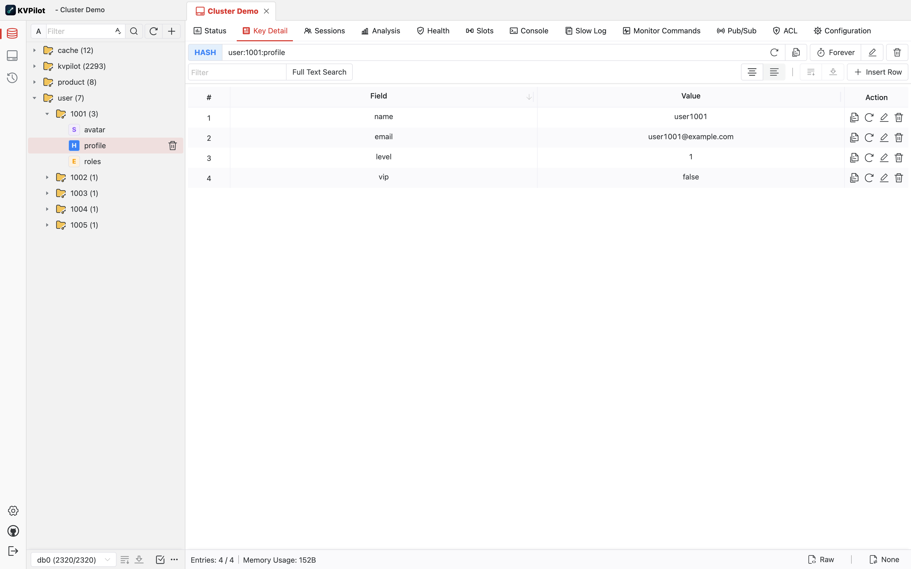
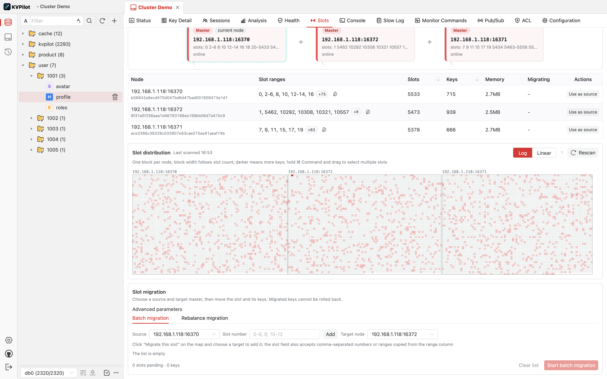

<div align="center">
<a href="https://github.com/zhizuqiu/kvpilot/"></a>
</div>

<h1 align="center">KVPilot</h1>
<h4 align="center"><strong>English</strong> | <a href="https://github.com/zhizuqiu/kvpilot/blob/main/README_zh.md">简体中文</a></h4>

> **KVPilot** is an unofficial community continuation of **Tiny RDM** 1.2.7 (GPL-3.0).
> Current release: **1.3.0**.
> Not affiliated with, endorsed by, or sponsored by Tiny Craft.

<div align="center">

[](https://github.com/zhizuqiu/kvpilot/blob/main/LICENSE)
[](https://github.com/zhizuqiu/kvpilot/releases)

[](https://github.com/zhizuqiu/kvpilot/stargazers)
[](https://github.com/zhizuqiu/kvpilot/fork)

<strong>KVPilot is a modern lightweight cross-platform Redis desktop manager available for Mac, Windows, and Linux. It
also provides a web version that can be deployed via Docker.</strong>
</div>

<div align="center">





</div>

## Feature

* Super lightweight, built on Webview2, without embedded browsers (Thanks
  to [Wails](https://github.com/wailsapp/wails)).
* Provides visually and user-friendly UI, light and dark themes (Thanks
  to [Naive UI](https://github.com/tusen-ai/naive-ui)
  and [IconPark](https://iconpark.oceanengine.com)).
* Multi-language support: English, 简体中文, 繁體中文, 日本語, 한국어, Français, Español, Português, Русский, Türkçe ([Need more languages ? Click here to contribute](.github/CONTRIBUTING.md)).
* Better connection management: supports SSH Tunnel/SSL/Sentinel Mode/Cluster Mode/HTTP proxy/SOCKS5 proxy.
* Visualize key value operations, CRUD support for Lists, Hashes, Strings, Sets, Sorted Sets, and Streams.
* Support multiple data viewing format and decode/decompression methods.
* Use SCAN for segmented loading, making it easy to list millions of keys.
* Logs list for command operation history.
* Provides command-line mode.
* Provides slow logs list.
* Segmented loading and querying for List/Hash/Set/Sorted Set.
* Provide value decode/decompression for List/Hash/Set/Sorted Set.
* Integrate with Monaco Editor
* Support real-time commands monitoring.
* Support import/export data.
* Support publish/subscribe.
* Support import/export connection profile.
* Custom data encoder and decoder for value
  display ([Here are the instructions](https://github.com/zhizuqiu/kvpilot/blob/main/docs/custom-decoder.md)).
* Deployment topology for standalone, master-replica, sentinel and cluster.
* Visual ACL management with permission dry-run and denial logs.
* Visual configuration management: view and edit Redis parameters, with per-node comparison for clusters.
* Session management with protection for master/replica/pub-sub connections.
* Big key scan and keyspace statistics (types, TTL, prefixes) with CSV export.
* Read-only cluster health checks with severity, reasons and suggestions.
* Maintenance actions: per-master BGSAVE with progress, SLOWLOG reset.
* Cluster slot management: per-slot key distribution map, batch migration with range paste and multi-select, and rebalancing by slot count or key count.

## Cluster Operations

KVPilot includes read-only cluster inspection and controlled slot operations for Redis Cluster:

* **Slot distribution**: one block per master, colored by key count, with log/linear scales and hover details.
* **Batch migration**: click a slot on the map, choose a target master, then add it to the batch list. The slot field also accepts comma-separated numbers or ranges copied from the slot range column (`0-6, 8, 10-12`).
* **Multi-select**: hold ⌘ Command on macOS or Alt on other platforms and drag on the map to select a rectangle of slots.
* **Rebalance**: generate a plan by slot count or key count with an adjustable tolerance, then run it with pause/resume/cancel.
* **Safety**: slot operations run against masters only; completed slots are never rolled back; cancellation takes effect between slots; nodes that fail to respond during a scan are reported and excluded from the map.

## Installation

Prebuilt packages for macOS (Apple Silicon / Intel), Windows and Linux are available on
the [releases page](https://github.com/zhizuqiu/kvpilot/releases).

> macOS builds are ad-hoc signed, so Gatekeeper may block the first launch. Remove the
> quarantine attribute once, then reopen:
> ``` shell
>  sudo xattr -d com.apple.quarantine /Applications/KVPilot.app
> ```

> Windows builds are not code signed yet, so SmartScreen may warn on first launch.
> Choose **More info → Run anyway**. Code signing is being arranged; once it is in place
> the release assets will be signed and the warning disappears.

Prefer the browser? See [Docker Deployment](#docker-deployment) for the web version.

## Build Guidelines

### Prerequisites

* Go >= 1.25
* Node.js >= 20
* NPM >= 9

### Install Wails

```bash
go install github.com/wailsapp/wails/v2/cmd/wails@latest
```

### Pull the Code

```bash
git clone https://github.com/zhizuqiu/kvpilot --depth=1
```

### Build Frontend

```bash
npm install --prefix ./frontend
```

or

```bash
cd frontend
npm install
```

### Compile and Run

```bash
wails dev
```

### Tests and Local Web Development

Run the test suites:

```bash
go test ./...
cd frontend && npm run test
```

For local web development, run the API server and the Vite dev server separately:

```bash
# terminal 1: backend on :8088
go build -tags web -o /tmp/kvpilot-web . && PORT=8088 /tmp/kvpilot-web

# terminal 2: frontend dev server, proxying /api and /ws to :8088
cd frontend && VITE_WEB=true npm run dev
```

## Docker Deployment

Images are published to Docker Hub as [`zhizuqiu/kvpilot`](https://hub.docker.com/r/zhizuqiu/kvpilot)
for `linux/amd64` and `linux/arm64`. In addition to the desktop client, the same image
serves the web version.

### Using Docker Compose (Recommended)

Create a `docker-compose.yml` file:

```yaml
services:
  kvpilot:
    image: zhizuqiu/kvpilot:latest
    container_name: kvpilot
    restart: unless-stopped
    ports:
      - "8086:8086"
    environment:
      - ADMIN_USERNAME=admin
      - ADMIN_PASSWORD=change-me
      - SESSION_TTL=24h
    volumes:
      - ./data:/app/tinyrdm
```

Start the service:

```bash
docker compose up -d
```

Once started, visit `http://localhost:8086` and log in with the credentials configured above.
The frontend uses `./` relative asset/API/WebSocket paths by default, so it can be served at the root
or under a sub-path such as `/kvpilot/`. Override the build base path with
`--build-arg VITE_BASE_PATH=...` when building the image.

### Using Docker Command

```bash
docker run -d --name kvpilot \
  -p 8086:8086 \
  -e ADMIN_USERNAME=admin \
  -e ADMIN_PASSWORD=change-me \
  -v ./data:/app/tinyrdm \
  zhizuqiu/kvpilot:latest
```

### Environment Variables

| Variable            | Description                                                                                  | Default |
|---------------------|----------------------------------------------------------------------------------------------|---------|
| `ADMIN_USERNAME`    | Login username                                                                               | -       |
| `ADMIN_PASSWORD`    | Login password                                                                               | -       |
| `SESSION_TTL`       | Login session lifetime, in Go duration format (for example `24h`)                            | `24h`   |
| `PORT`              | Backend listen port inside the container; nginx exposes `8086`                               | `8088`  |

Connections and preferences are stored under `/app/tinyrdm`. Keep that volume before upgrading or
recreating the container. Web mode uses a single administrator account; put it behind HTTPS when
exposed to a network.

## About

KVPilot is a community continuation of [Tiny RDM](https://github.com/tiny-craft/tiny-rdm) 1.2.7,
aimed at users who still rely on the open-source desktop client and need to keep up with
new Redis / KV compatible implementations.

- Scope: bug fixes, dependency and security updates, Redis protocol/command compatibility, cluster slot operations, and hardening of the web mode
- Current release: 1.3.0 (based on Tiny RDM 1.2.7)
- Non-goals: major UI redesigns, chasing features of the closed-source successor (Redisee)
- Maintenance: issue/PR driven, see [Contributing](#contributing)
- License: GPL-3.0; unofficial derivative work, not affiliated with Tiny Craft

## Contributing

- Issues and feature requests: <https://github.com/zhizuqiu/kvpilot/issues>
- Upstream project: [Tiny RDM](https://github.com/tiny-craft/tiny-rdm); thanks to its authors
- License: [GPL-3.0](LICENSE); third-party notices in [NOTICE](NOTICE)
