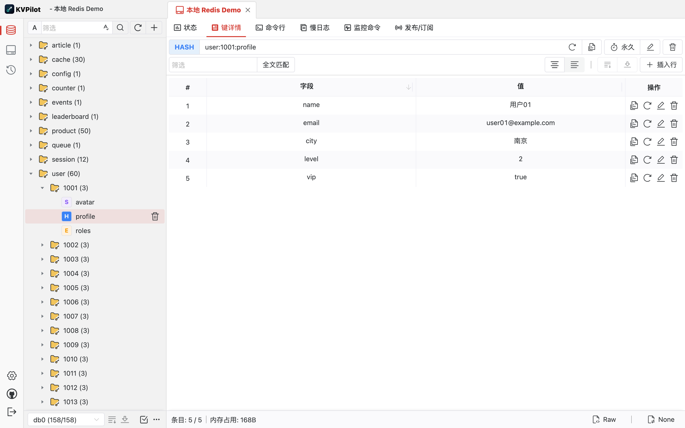

<div align="center">
<a href="https://github.com/zhizuqiu/kvpilot/"></a>
</div>

<h1 align="center">KVPilot</h1>
<h4 align="center"><a href="/">English</a> | <a href="https://github.com/zhizuqiu/kvpilot/blob/main/README_zh.md">简体中文</a> | <a href="https://github.com/zhizuqiu/kvpilot/blob/main/README_tw.md">繁體中文</a> | <a href="https://github.com/zhizuqiu/kvpilot/blob/main/README_ja.md">日本語</a> | <a href="https://github.com/zhizuqiu/kvpilot/blob/main/README_ko.md">한국어</a> | <strong>Français</strong> | <a href="https://github.com/zhizuqiu/kvpilot/blob/main/README_es.md">Español</a> | <a href="https://github.com/zhizuqiu/kvpilot/blob/main/README_pt.md">Português (BR)</a> | <a href="https://github.com/zhizuqiu/kvpilot/blob/main/README_ru.md">Русский</a> | <a href="https://github.com/zhizuqiu/kvpilot/blob/main/README_tr.md">Türkçe</a></h4>

> **KVPilot** is an unofficial community continuation of **Tiny RDM** 1.2.7 (GPL-3.0).
> Not affiliated with, endorsed by, or sponsored by Tiny Craft.

<div align="center">

[](https://github.com/zhizuqiu/kvpilot/blob/main/LICENSE)
[](https://github.com/zhizuqiu/kvpilot/releases)

[](https://github.com/zhizuqiu/kvpilot/stargazers)
[](https://github.com/zhizuqiu/kvpilot/fork)

<strong>KVPilot est un gestionnaire Redis moderne, léger et multiplateforme, disponible pour Mac, Windows et Linux. Une
version web déployable via Docker est également proposée.</strong>
</div>

<div align="center">





</div>

## Fonctionnalités

* Ultra léger, basé sur Webview2, sans navigateur intégré (Merci à [Wails](https://github.com/wailsapp/wails))
* Interface visuelle et conviviale, thèmes clair et sombre (Merci à [Naive UI](https://github.com/tusen-ai/naive-ui)
  et [IconPark](https://iconpark.oceanengine.com))
* Support multilingue ([Besoin de plus de langues ? Cliquez ici pour contribuer](.github/CONTRIBUTING.md))
* Gestion améliorée des connexions : tunnel SSH/SSL/mode Sentinelle/mode Cluster/proxy HTTP/proxy SOCKS5
* Visualisation des opérations clé-valeur, support CRUD pour List, Hash, String, Set, Sorted Set et Stream
* Support de multiples formats d'affichage et méthodes de décodage/décompression
* Chargement segmenté avec SCAN pour lister facilement des millions de clés
* Liste des journaux d'historique des commandes
* Mode ligne de commande
* Liste des journaux lents
* Chargement segmenté et requêtes pour List/Hash/Set/Sorted Set
* Décodage/décompression des valeurs pour List/Hash/Set/Sorted Set
* Intégration de Monaco Editor
* Surveillance des commandes en temps réel
* Import/export de données
* Publication/abonnement
* Import/export de profils de connexion
* Encodeur et décodeur de données personnalisés pour l'affichage des
  valeurs ([Instructions ici](https://github.com/zhizuqiu/kvpilot/blob/main/docs/custom-decoder.md))

## Installation

Disponible en téléchargement gratuit [ici](https://github.com/zhizuqiu/kvpilot/releases).

> Si vous ne pouvez pas l'ouvrir après l'installation sur macOS, exécutez la commande suivante puis relancez :
> ``` shell
>  sudo xattr -d com.apple.quarantine /Applications/Tiny\ RDM.app
> ```

## Guide de compilation

### Prérequis

* Go (dernière version)
* Node.js >= 20
* NPM >= 9

### Installer Wails

```bash
go install github.com/wailsapp/wails/v2/cmd/wails@latest
```

### Récupérer le code

```bash
git clone https://github.com/zhizuqiu/kvpilot --depth=1
```

### Compiler le frontend

```bash
npm install --prefix ./frontend
```

ou

```bash
cd frontend
npm install
```

### Compiler et exécuter

```bash
wails dev
```

## Déploiement Docker

> No official image is published yet. Build it locally from the repository root: `docker build -f Dockerfile.local -t kvpilot:1.2.8 .`


En plus du client de bureau, KVPilot propose une version web déployable rapidement via Docker.

### Avec Docker Compose (recommandé)

Créez un fichier `docker-compose.yml` :

```yaml
services:
  kvpilot:
    image: kvpilot:1.2.8
    container_name: kvpilot
    restart: unless-stopped
    ports:
      - "8086:8086"
    environment:
      - ADMIN_USERNAME=admin
      - ADMIN_PASSWORD=change-me
    volumes:
      - ./data:/app/tinyrdm
```

Démarrez le service :

```bash
docker compose up -d
```

Une fois démarré, accédez à `http://localhost:8086` et connectez-vous avec les identifiants configurés ci-dessus.

### Avec la commande Docker

```bash
docker run -d --name kvpilot \
  -p 8086:8086 \
  -e ADMIN_USERNAME=admin \
  -e ADMIN_PASSWORD=change-me \
  -v ./data:/app/tinyrdm \
  kvpilot:1.2.8
```

### Variables d'environnement

| Variable         | Description       | Valeur par défaut |
|------------------|-------------------|-------------------|
| `ADMIN_USERNAME` | Nom d'utilisateur | -                 |
| `ADMIN_PASSWORD` | Mot de passe      | -                 |

## Contributing

- Issues and feature requests: <https://github.com/zhizuqiu/kvpilot/issues>
- Upstream project: [Tiny RDM](https://github.com/tiny-craft/tiny-rdm); thanks to its authors
- License: [GPL-3.0](LICENSE); third-party notices in [NOTICE](NOTICE)
