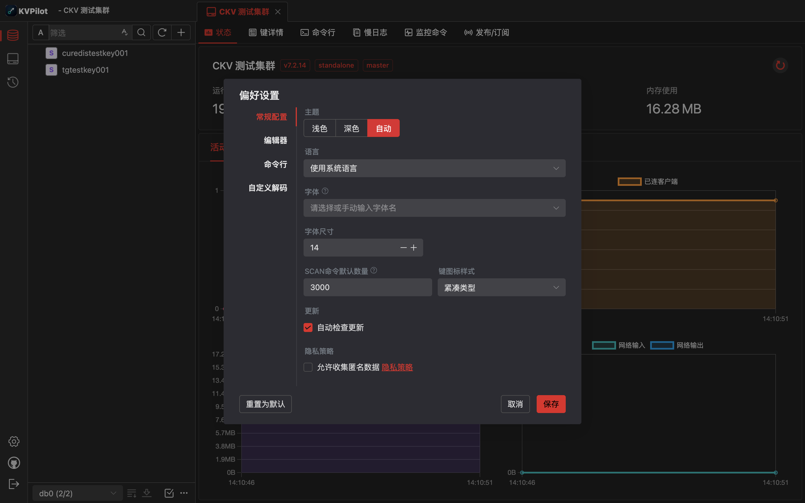

<div align="center">
<a href="https://github.com/zhizuqiu/kvpilot/"></a>
</div>

<h1 align="center">KVPilot</h1>
<h4 align="center"><a href="/">English</a> | <a href="https://github.com/zhizuqiu/kvpilot/blob/main/README_zh.md">简体中文</a> | <a href="https://github.com/zhizuqiu/kvpilot/blob/main/README_tw.md">繁體中文</a> | <strong>日本語</strong> | <a href="https://github.com/zhizuqiu/kvpilot/blob/main/README_ko.md">한국어</a> | <a href="https://github.com/zhizuqiu/kvpilot/blob/main/README_fr.md">Français</a> | <a href="https://github.com/zhizuqiu/kvpilot/blob/main/README_es.md">Español</a> | <a href="https://github.com/zhizuqiu/kvpilot/blob/main/README_pt.md">Português (BR)</a> | <a href="https://github.com/zhizuqiu/kvpilot/blob/main/README_ru.md">Русский</a> | <a href="https://github.com/zhizuqiu/kvpilot/blob/main/README_tr.md">Türkçe</a></h4>

> **KVPilot** is an unofficial community continuation of **Tiny RDM** 1.2.7 (GPL-3.0).
> Not affiliated with, endorsed by, or sponsored by Tiny Craft.

<div align="center">

[](https://github.com/zhizuqiu/kvpilot/blob/main/LICENSE)
[](https://github.com/zhizuqiu/kvpilot/releases)

[](https://github.com/zhizuqiu/kvpilot/stargazers)
[](https://github.com/zhizuqiu/kvpilot/fork)

<strong>Tiny
RDMは、Mac、Windows、Linuxで利用可能な、モダンで軽量なクロスプラットフォームのRedisデスクトップマネージャーです。Docker経由でデプロイ可能なWeb版も提供しています。</strong>
</div>

<div align="center">



</div>

## 特徴

* 超軽量、Webview2をベースにしており、埋め込みブラウザなし（[Wails](https://github.com/wailsapp/wails)に感謝）。
* 視覚的でユーザーフレンドリーなUI、ライトとダークテーマを提供（[Naive UI](https://github.com/tusen-ai/naive-ui)
  と[IconPark](https://iconpark.oceanengine.com)に感謝）。
* 多言語サポート（[もっと多くの言語が必要ですか？ここをクリックして貢献してください](.github/CONTRIBUTING.md)）。
* より良い接続管理：SSHトンネル/SSL/センチネルモード/クラスターモード/HTTPプロキシ/SOCKS5プロキシをサポート。
* キー値操作の可視化、リスト、ハッシュ、文字列、セット、ソートセット、ストリームのCRUDサポート。
* 複数のデータ表示形式とデコード/解凍方法をサポート。
* SCANを使用してセグメント化された読み込みを行い、数百万のキーを簡単にリスト化。
* コマンド操作履歴のログリスト。
* コマンドラインモードを提供。
* スローログリストを提供。
* リスト/ハッシュ/セット/ソートセットのセグメント化された読み込みとクエリ。
* リスト/ハッシュ/セット/ソートセットの値のデコード/解凍を提供。
* Monaco Editorと統合。
* リアルタイムコマンド監視をサポート。
* データのインポート/エクスポートをサポート。
* パブリッシュ/サブスクライブをサポート。
* 接続プロファイルのインポート/エクスポートをサポート。
*
値表示のためのカスタムデータエンコーダーとデコーダーをサポート（[こちらが手順です](https://github.com/zhizuqiu/kvpilot/blob/main/docs/custom-decoder.md)）。

## インストール

[こちら](https://github.com/zhizuqiu/kvpilot/releases)から無料でダウンロードできます。

> macOSにインストール後に開けない場合、**信頼されていない**または**ゴミ箱に移動**というエラーが表示された場合は、以下のコマンドを実行してから再度開いてください：
> ``` shell
>  sudo xattr -d com.apple.quarantine /Applications/Tiny\ RDM.app
> ```

## ビルドガイドライン

### 前提条件

* Go（最新バージョン）
* Node.js >= 20
* NPM >= 9

### Wailsのインストール

```bash
go install github.com/wailsapp/wails/v2/cmd/wails@latest
```

### コードの取得

```bash
git clone https://github.com/zhizuqiu/kvpilot --depth=1
```

### フロントエンドのビルド

```bash
npm install --prefix ./frontend
```

または

```bash
cd frontend
npm install
```

### コンパイルと実行

```bash
wails dev
```

## Dockerデプロイ

デスクトップクライアントに加えて、KVPilotはDockerで素早くデプロイできるWeb版も提供しています。

### Docker Composeを使用（推奨）

`docker-compose.yml` ファイルを作成します：

```yaml
services:
  tinyrdm:
    image: ghcr.io/zhizuqiu/kvpilot:latest
    container_name: tinyrdm
    restart: unless-stopped
    ports:
      - "8086:8086"
    environment:
      - ADMIN_USERNAME=admin
      - ADMIN_PASSWORD=tinyrdm
    volumes:
      - ./data:/app/tinyrdm
```

サービスを起動します：

```bash
docker compose up -d
```

起動後、`http://localhost:8086` にアクセスし、上記で設定したユーザー名とパスワードでログインしてください。

### Dockerコマンドを使用

```bash
docker run -d --name tinyrdm \
  -p 8086:8086 \
  -e ADMIN_USERNAME=admin \
  -e ADMIN_PASSWORD=tinyrdm \
  -v ./data:/app/tinyrdm \
  ghcr.io/zhizuqiu/kvpilot:latest
```

### 環境変数の説明

| 変数               | 説明        | デフォルト値 |
|------------------|-----------|--------|
| `ADMIN_USERNAME` | ログインユーザー名 | -      |
| `ADMIN_PASSWORD` | ログインパスワード | -      |

## スポンサー

以下のサービスプロバイダーによるホスティングスポンサーに感謝いたします

<table>
<tr>
<td width="200"><a href="https://flymux.com/register?promo=TINYRDM"></a></td>
<td>本プロジェクトをスポンサーしてくださった FlyMux に心より感謝します。FlyMux は Claude Code と Codex 向けの公式かつ高安定なリレーサービスの提供に注力し、開発者にスムーズで効率的な AI コーディングへの接続体験を届けています。TinyRDM ユーザー向けの特典として、<a href="https://flymux.com/register?promo=TINYRDM">このリンク</a>から登録すると、アカウントに $5 のボーナスクレジットが自動で追加されます。</td>
</tr>
<tr>
<td width="200"><a href="https://www.notidc.com/"></a></td>
<td>本プロジェクトをスポンサーしてくださった NotiDC に心より感謝します。NotIDC はクラウドサーバー、ベアメタル、CDN、セキュリティソリューションを含む高性能なクラウドインフラを提供しており、グローバルなネットワークカバレッジと信頼性の高い DDoS 対策によって、開発者の効率的なデプロイとスケールを支援します。</td>
</tr>
</table>

## について

### WeChat公式アカウント


