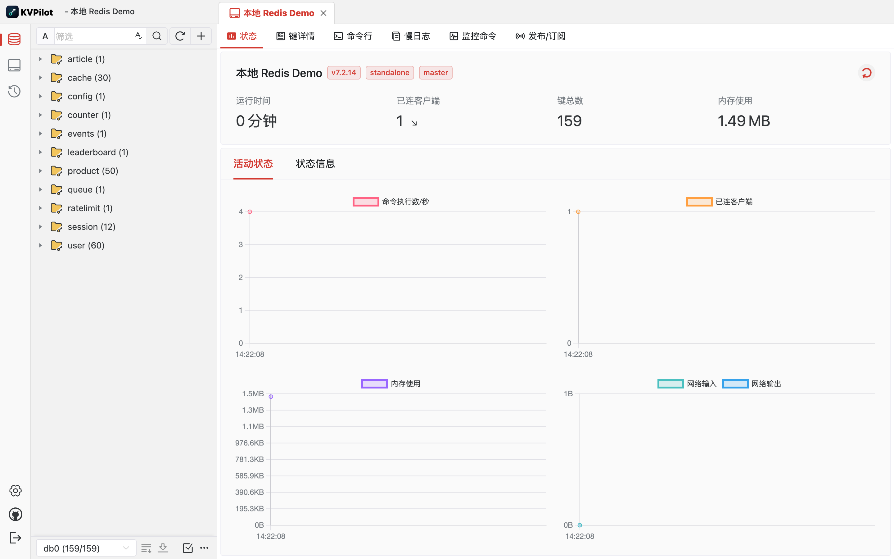
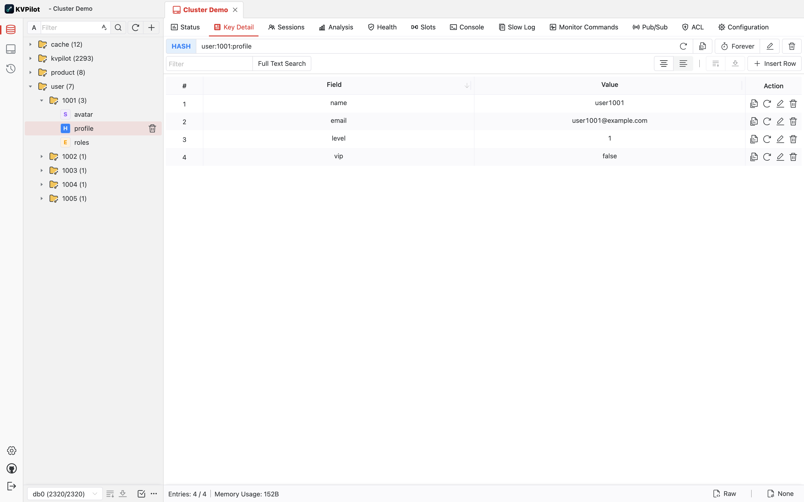

<div align="center">
<a href="https://github.com/zhizuqiu/kvpilot/"></a>
</div>

<h1 align="center">KVPilot</h1>
<h4 align="center"><a href="https://github.com/zhizuqiu/kvpilot/blob/main/README.md">English</a> | <strong>简体中文</strong></h4>

> **KVPilot** 是 **Tiny RDM** 1.2.7 的非官方社区延续分支（GPL-3.0）。
> 与 Tiny Craft 无隶属、背书或赞助关系。

<div align="center">

[](https://github.com/zhizuqiu/kvpilot/blob/main/LICENSE)
[](https://github.com/zhizuqiu/kvpilot/releases)

[](https://github.com/zhizuqiu/kvpilot/stargazers)
[](https://github.com/zhizuqiu/kvpilot/fork)

<strong>一个现代化轻量级的跨平台Redis桌面客户端，支持Mac、Windows和Linux，同时提供Web版本，可通过Docker快速部署</strong>
</div>

<div align="center">





</div>

## 功能特性

* 极度轻量，基于Webview2，无内嵌浏览器（感谢[Wails](https://github.com/wailsapp/wails)）
* 界面精美易用，提供浅色/深色主题（感谢[Naive UI](https://github.com/tusen-ai/naive-ui)
  和 [IconPark](https://iconpark.oceanengine.com)）
* 多国语言支持：英文/中文（[需要更多语言支持？点我贡献语言](.github/CONTRIBUTING_zh.md)）
* 更好用的连接管理：支持SSH隧道/SSL/哨兵模式/集群模式/HTTP代理/SOCKS5代理
* 可视化键值操作，增删查改一应俱全
* 支持多种数据查看格式以及转码/解压方式
* 采用SCAN分段加载，可轻松处理数百万键列表
* 操作命令执行日志展示
* 提供命令行操作
* 提供慢日志展示
* List/Hash/Set/Sorted Set的分段加载和查询
* List/Hash/Set/Sorted Set值的转码显示
* 内置高级编辑器Monaco Editor
* 支持命令实时监控
* 可视化 ACL 管理，支持权限试算与拒绝日志
* 部署拓扑视图，支持单机/主从/哨兵/集群
* 支持导入/导出数据
* 支持发布订阅
* 支持导入/导出连接配置
* 自定义数据展示编码/解码([这是操作指引](https://github.com/zhizuqiu/kvpilot/blob/main/docs/custom-decoder.md))

## 安装

提供 macOS（Apple Silicon / Intel）、Windows 和 Linux 安装包，可在[发布页](https://github.com/zhizuqiu/kvpilot/releases)下载。

> macOS 版本为 ad-hoc 签名，首次打开可能被系统拦截。执行一次下面的命令后再启动即可：
> ``` shell
>  sudo xattr -d com.apple.quarantine /Applications/KVPilot.app
> ```

> Windows 版本暂未代码签名，首次运行可能弹出 SmartScreen 提示，选择**更多信息 → 仍要运行**即可。
> 代码签名正在申请中，通过后会替换为已签名的安装包，提示随之消失。

想用浏览器访问？参见 [Docker 部署](#docker-部署)。

## 构建客户端

### 运行环境要求

* Go（最新版本）
* Node.js >= 20
* NPM >= 9

### 安装wails

```bash
go install github.com/wailsapp/wails/v2/cmd/wails@latest
```

### 拉取代码

```bash
git clone https://github.com/zhizuqiu/kvpilot --depth=1
```

### 构建前端代码

```bash
npm install --prefix ./frontend
```

或者

```bash
cd frontend
npm install
```

### 编译运行开发版本

```bash
wails dev
```

## Docker 部署

镜像发布在 Docker Hub：[`zhizuqiu/kvpilot`](https://hub.docker.com/r/zhizuqiu/kvpilot)，
提供 `linux/amd64` 与 `linux/arm64` 两个架构。除桌面客户端外，Web 版也由同一个镜像提供。

### 使用 Docker Compose（推荐）

创建 `docker-compose.yml` 文件：

```yaml
services:
  kvpilot:
    image: zhizuqiu/kvpilot:latest
    container_name: kvpilot
    restart: unless-stopped
    ports:
      - "8086:8086"
    environment:
      - ADMIN_USERNAME=admin
      - ADMIN_PASSWORD=change-me
    volumes:
      - ./data:/app/tinyrdm
```

启动服务：

```bash
docker compose up -d
```

启动后访问 `http://localhost:8086`，使用上面配置的用户名密码登录。

### 使用 Docker 命令

```bash
docker run -d --name kvpilot \
  -p 8086:8086 \
  -e ADMIN_USERNAME=admin \
  -e ADMIN_PASSWORD=change-me \
  -v ./data:/app/tinyrdm \
  zhizuqiu/kvpilot:latest
```

### 环境变量说明

| 变量               | 说明    | 默认值 |
|------------------|-------|-----|
| `ADMIN_USERNAME` | 登录用户名 | -   |
| `ADMIN_PASSWORD` | 登录密码  | -   |

## 关于

KVPilot 是 [Tiny RDM](https://github.com/tiny-craft/tiny-rdm) 1.2.7 的社区延续分支，
面向仍在使用开源桌面客户端、且需要跟进新 Redis / KV 兼容实现的用户。

- 项目范围：缺陷修复、依赖安全升级、Redis 协议与命令兼容、Web 模式加固
- 非目标：不做界面大改、不追上游闭源版本（Redisee）的功能
- 维护方式：Issue / PR 驱动，见 [参与贡献](#参与贡献)
- 许可证：GPL-3.0，非官方衍生版本，与 Tiny Craft 无隶属关系

## 参与贡献

- 问题反馈与功能建议：<https://github.com/zhizuqiu/kvpilot/issues>
- 本项目上游为 [Tiny RDM](https://github.com/tiny-craft/tiny-rdm)，感谢原作者的开源工作
- 许可证：[GPL-3.0](LICENSE)，第三方组件许可见 [NOTICE](NOTICE)
